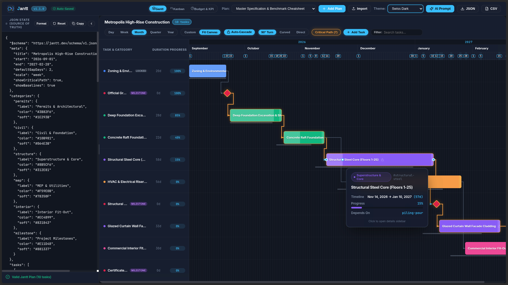
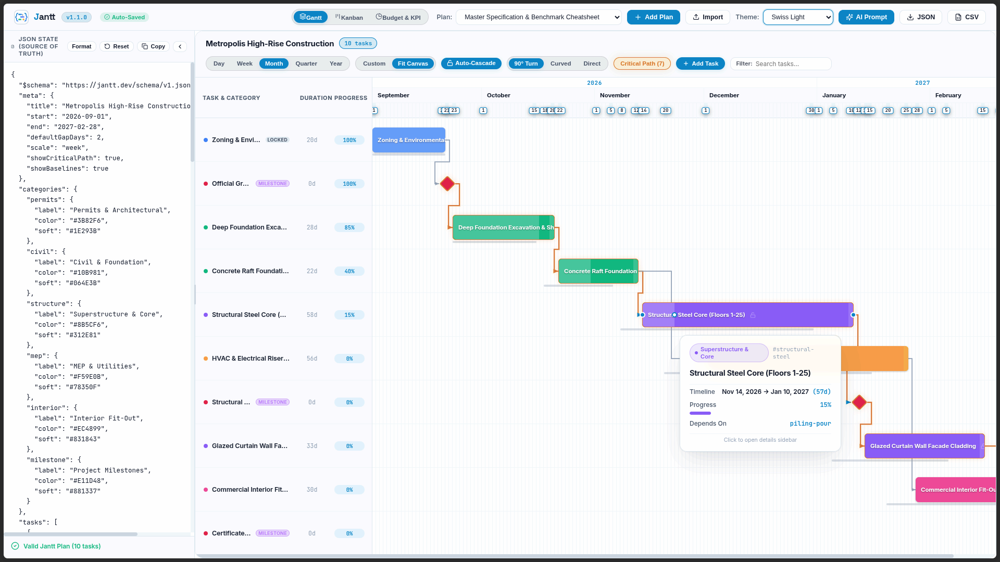
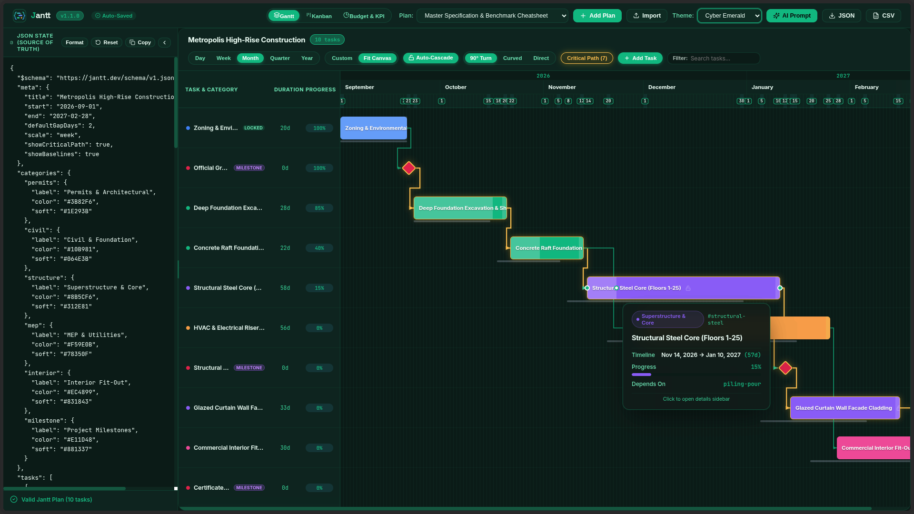
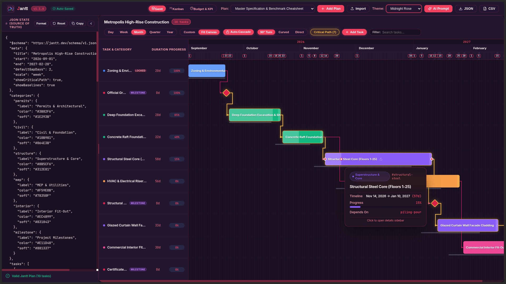
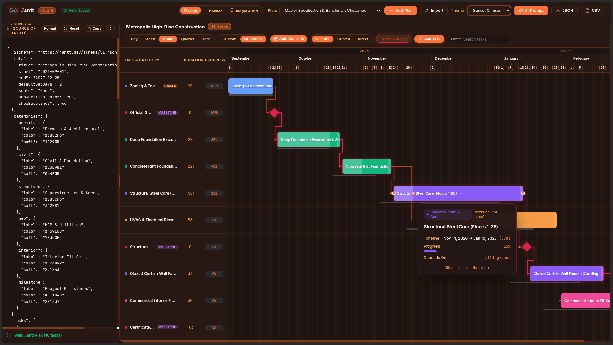
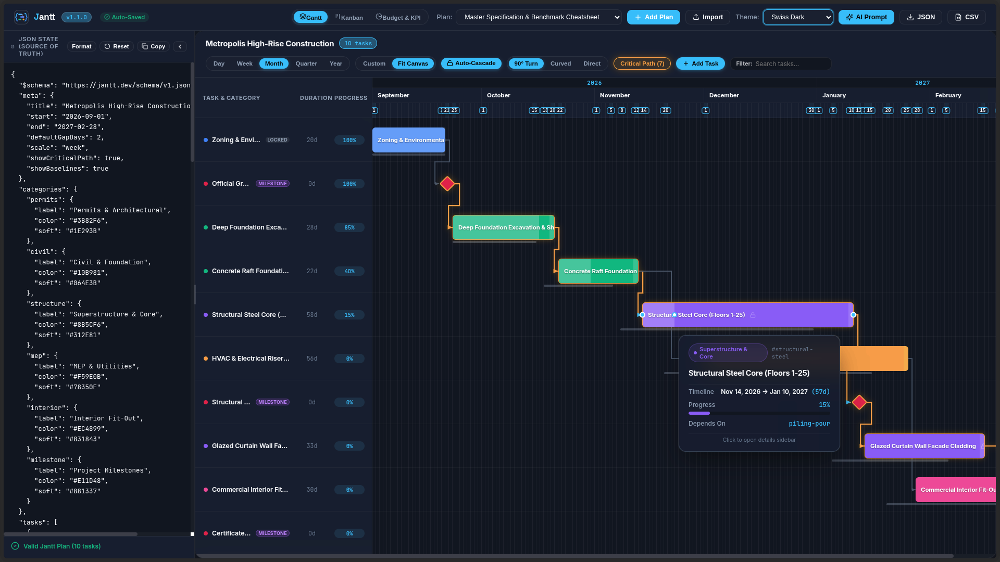
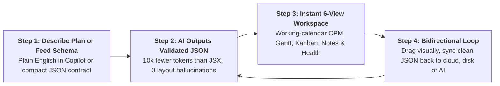
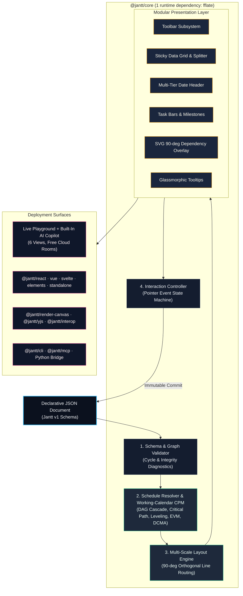

<div align="center">


<br />

# Create Interactive Gantt Charts with AI: No Code Required.

**Simple enough to organize your semester, wedding, or team meeting in 60 seconds.**  
**Powerful enough for working-calendar Critical Path analysis, 100,000-task Canvas rendering, and Microsoft Project / Primavera P6 teams.**

[](https://opensource.org/licenses/MIT)
[-10B981.svg?style=flat-square)](https://ahmadhassan-bted.github.io/Jantt/)
[](https://www.typescriptlang.org/)
[-10B981.svg?style=flat-square)](https://www.npmjs.com/package/@jantt/core)
[](https://github.com/AhmadHassan-BTed/Jantt/actions/workflows/ci.yml)
[](https://www.npmjs.com/org/jantt)
[](https://nodejs.org/)
[](https://github.com/AhmadHassan-BTed/Jantt/blob/main/CONTRIBUTING.md)

<br />

<p align="center">
  <a href="https://trendshift.io/repositories/247657?utm_source=trendshift-badge&amp;utm_medium=badge&amp;utm_campaign=badge-trendshift-247657" target="_blank" rel="noopener noreferrer"></a>
  <a href="https://trendshift.io/repositories/247657?utm_source=trendshift-badge&amp;utm_medium=badge&amp;utm_campaign=badge-trendshift-247657" target="_blank" rel="noopener noreferrer"></a>
</p>

<h3>
  <a href="https://ahmadhassan-bted.github.io/Jantt/"><strong>Launch Free Live App (No Sign-Up Required)</strong></a>
</h3>

[Create with AI](#create-and-edit-gantt-charts-with-ai-built-in-copilot) • [Who Uses Jantt](#built-for-everyone-real-world-use-cases) • [6 Synced Views](#one-plan-six-synchronized-views) • [Compare Tools](#how-jantt-compares) • [Free Cloud Sync](#free-cloud-collaboration-and-zero-lock-in-privacy) • [Developer Quickstarts](#developer-and-ai-agent-quickstarts) • [Docs](./docs/api-reference.md)

<br />



</div>

---

## Simple on the Surface. Rocket Engine Underneath.

Most timeline tools force an unfair trade-off: spreadsheets break the moment one date slips, commercial Gantt suites lock basic features behind \$15–\$49/user/month paywalls, and asking ChatGPT to code an HTML/Mermaid chart gives you a static, broken picture you cannot drag or update.

**Jantt removes every barrier at once:**

| Promise | What It Means for You |
| :--- | :--- |
| **No Code Needed** | Drag bars visually, resize deadlines, connect arrows, or describe your plan in plain English to the built-in AI Copilot. You never have to write a single line of code or JSON unless you want to. |
| **Free Forever + Free Cloud Rooms** | 100% MIT open source. Use offline in your browser with **zero sign-up**, or sign in free with GitHub for **real-time multi-user cloud rooms**, shareable links, and unlimited exports. |
| **100% Client-Side Privacy** | Your local schedules stay in your browser. BYOK AI calls go directly from your browser to your provider (or run **100% offline and free with Ollama**). Zero lock-in: every plan is clean, portable JSON you own. |
| **Grows With Your Ambition** | Start with a 5-task study checklist today; unlock working-calendar Critical Path analysis, Earned Value Management (EVM), Monte Carlo risk simulation, 60 FPS Canvas, and MS Project / Primavera P6 interop whenever you need them. |

---

## Create and Edit Gantt Charts with AI (Built-In Copilot)

Stop wrestling with spreadsheet rows or begging chatbots for fragile SVG/React code. Jantt ships a **built-in AI Copilot** directly inside the live workspace: just open the Copilot drawer and describe what you want in plain English.

### How It Works in 3 Steps
1. **Describe or Paste Anything in Plain English:** Type a goal, paste messy meeting notes, or ask to push deadlines, flag urgent risks, rebalance workloads, or add milestones.
2. **Review the Visual Diff Preview:** Jantt validates the AI's structured output against its strict schema and displays an exact **added / updated / removed diff preview** before touching your schedule. Zero surprise overwrites.
3. **Apply in One Click:** Accept the change with full **Undo / Redo** support. Dependencies automatically cascade, working days recalculate, and all 6 views update immediately.

### Bring Your Own Key (10 Providers) or Run 100% Free & Local
Your API keys stay strictly in your browser's `localStorage` and connect directly to your provider: never through a Jantt proxy. **Live dynamic model discovery** (`/models` and Ollama `/api/tags`) automatically fetches the latest models from your account with instant search and context-window tags.

| Provider Category | Supported Providers |
| :--- | :--- |
| **Generous Free Tiers** | **Google Gemini** (Google AI Studio), **Groq**, **OpenRouter** |
| **Frontier Cloud Models** | **OpenAI**, **Anthropic Claude**, **DeepSeek**, **Mistral**, **xAI Grok** |
| **100% Free & Offline Local** | **Ollama** (Llama, Qwen, DeepSeek, Gemma running privately on your own machine) |
| **Custom Endpoints** | Any **OpenAI-compatible** gateway, corporate endpoint, or local server (LM Studio, vLLM) |

### Try Prompts Like These Right Now
- **Student Thesis & Exams:** *"Build a 12-week Master's thesis timeline from literature review to final defense, Monday through Friday only, with advisor review milestones and exam prep buffer."*
- **Personal Life & Moving:** *"Organize a 6-week apartment move with packing rooms, utility transfers, lease handoff, and a budget under \$2,500."*
- **Team Meeting to Action Plan:** *"Turn these meeting notes into a 4-week product launch Gantt chart with owners, dependencies, and urgent blockers highlighted."*
- **Live Schedule Surgery:** *"Push the QA phase back by 5 working days, mark the security audit urgent, and tell me what just became the bottleneck."*

---

## Built for Everyone: Real-World Use Cases

Jantt is not just for Fortune 500 schedulers or software engineers. Open [the live app](https://ahmadhassan-bted.github.io/Jantt/) and start organizing whatever matters to you right now:

### Organizing for Students, PhD/MS Applicants & Researchers
- **University & Scholarship Pipelines:** Track PhD/MS deadlines, GRE/IELTS prep, Statement of Purpose drafts, recommendation letter reminders, and application fees in one calm timeline.
- **Semester, Thesis & Exam Planning:** Map coursework, lab experiments, advisor sign-off milestones, and revision weeks, then flip to **Checklist View** each morning to tick off today's work with one click.
- **Zero Cost for Students:** Free forever, instant browser auto-save, and one-click JSON/CSV/PDF backup for advisor check-ins.

### Personal Life Organizers, Freelancers & Everyday Planning
- **Life Milestones Made Visual:** Plan weddings, moving apartments, home renovations, international travel itineraries, fitness/learning sprints, or side-hustle launches without fighting messy spreadsheets.
- **See What Matters Today:** Hit the **Today** jump button or toggle the 1-click focus bar (**Today**, **This Week**, **Date Range**) with **Dim Mode** (softly fades other tasks) or **Hide Mode** so big plans never feel overwhelming.
- **Built-In Budget Tracking:** Track estimated vs. actual spending on every task to see whether your personal project is under or over budget at a glance.

### Meetings, Standups, Agencies & Small Teams
- **Turn Chaotic Meetings Into Clear Commitments:** Paste raw meeting minutes into the AI Copilot to generate tasks, owners, dates, and dependencies before the call even ends.
- **Collaborate in Free Cloud Rooms:** Sign in free with GitHub to turn any local plan into a live shared room with **Owner**, **Editor**, and **Viewer** permissions, `@username` mentions, and instant multi-user sync.
- **Share Anywhere in One Click:** Send a compressed **read-only snapshot link**, embed an interactive chart, or export a clean multi-page **Executive HTML/PDF report** for clients and leadership.
- **Notes Right Next to Tasks:** Keep Markdown meeting notes, specs, and decisions pinned alongside the timeline with clickable `@person` and `/task` references.

### Engineering Teams & Program Managers
- **Working-Calendar-Aware Critical Path (CPM):** Schedule cascades, Critical Path, float calculations, Resource Leveling, and DCMA-14 audits all honor the same working calendars: Mon-Fri (`standard`), Mon-Thu (`compressed_4x10`), 24/7 (`continuous`), US/UK/EU/CA/AU regional statutory holidays, custom named calendars, and per-person calendars.
- **Full ANSI/PMI Dependency Math:** Finish-to-Start (`FS`), Start-to-Start (`SS`), Finish-to-Finish (`FF`), and Start-to-Finish (`SF`) links with positive lags, negative leads, and `locked: true` hard milestones.
- **No More Expensive Legacy Viewer Seats:** Import and export **Microsoft Project `.xml`** and **Oracle Primavera P6 `.xer`** schedules directly in the browser or CLI.
- **Executive Analytics Built In:** Earned Value Management (**EVM: ANSI/EIA-748**), **DCMA-14** schedule health grading (`A`-`F`), **PERT** 3-point estimates, **5,000-run Monte Carlo** risk simulation, and automated **Resource Leveling** with preview before apply.

### Developers & Autonomous AI Agents
- **JSON-as-Interface (10x Fewer LLM Tokens):** Instead of asking AI models to hallucinate brittle React JSX or SVG coordinate math, models emit clean, validated Jantt JSON conforming to a formal JSON Schema (`schema/v1.json`).
- **Official MCP Server (`@jantt/mcp`):** Connect Claude Desktop, Cursor, Gemini, or custom AI agents directly to 6 deterministic scheduling tools (`jantt_inspect_plan`, `jantt_add_task`, `jantt_reschedule_task`, `jantt_audit_schedule`, `jantt_diff_plans`, `jantt_export_csv`).
- **Embed Anywhere:** First-class packages for **React**, **Vue 3**, **Svelte 4/5**, **Web Components**, **Plain HTML**, **Python / Jupyter / Streamlit**, **Yjs CRDT**, **60 FPS Canvas**, and a **two-way live-sync CLI**.

---

## One Plan, Six Synchronized Views

Edit a task in any view and every other view updates instantaneously. **Every page remembers your layout, scroll position, zoom level, filters, and toggles automatically across tabs and reloads.**

| View | Best For | Key Capabilities |
| :--- | :--- | :--- |
| **Interactive Gantt Timeline** | Visual scheduling & dependency flow | Drag bars to move, drag edges to resize, drag anchor ports for 90-degree CAD orthogonal links, inline progress slider, baseline comparison bars, 5 zoom scales (Day to Year) + continuous zoom, one-click **Jump to Today**, strict right-aligned Swiss micro-pills (`Urgent`, `Critical`, circular avatars, locks). |
| **60 FPS Canvas View** | Massive enterprise plans (10k–100k+ tasks) | Hardware-accelerated 2D virtualized canvas, live minimap, red Today guide line, working-calendar Critical Path overlay, smooth pan & zoom. |
| **Agile Kanban Board** | Daily execution & sprint standups | 4 workflow columns (`Pending`, `In Progress`, `Blocked`, `Completed`), drag-and-drop status cards, multi-rule sorting (Priority, Start Date, Assignee, WBS). |
| **Tasks Checklist & Grid** | Quick morning focus & bulk editing | 1-click `[x]` completion checkboxes, expandable cards, quick status/priority controls, inline **Resource Leveling** preview and apply. |
| **Health & PM Dashboard** | Tracking budgets, bottlenecks & risk | Dual-mode UI: **Essential** (clean readiness, velocity, blockers) and **Advanced** (EVM CPI/SPI/EAC, Critical Path slack, DCMA-14 health grade, PERT, Monte Carlo simulation). |
| **Collaborative Notes** | Meeting minutes, specs & study docs | Live Markdown editor & preview, `@person` and `/task` mentions, pinned notes, color coding, attached task cross-links saved directly inside the plan. |

---

## Visual Showcase & Curated Themes

Jantt features **7 handcrafted Swiss Modernism themes** (grouped cleanly into Dark and Light palettes) powered by CSS custom properties: zero visual clutter, zero emojis, crisp OLED readability.

<div align="center">

### Swiss Light Mode
*Daylight clarity, crisp contrast typography, and clean glassmorphic hover cards.*



<br />

### Swiss Dark Mode (Swiss Noir)
*True dark obsidian canvas with crisp critical path highlights and 90-degree right-angle routing.*


</div>

### Color Theme Gallery

<table>
  <tr>
    <td width="50%" align="center">
      <b>Cyber Emerald</b><br /><br />
      
    </td>
    <td width="50%" align="center">
      <b>Midnight Rose</b><br /><br />
      
    </td>
  </tr>
  <tr>
    <td width="50%" align="center">
      <b>Sunset Crimson</b><br /><br />
      
    </td>
    <td width="50%" align="center">
      <b>Master Specification Benchmark</b><br /><br />
      
    </td>
  </tr>
</table>

---

## How Jantt Compares

### For Everyday Users, Students & Teams

| Capability | Jantt (Live App) | Spreadsheets (Excel / Sheets) | Commercial PM Suites (TeamGantt / Asana / Monday) | ChatGPT HTML / Mermaid |
| :--- | :---: | :---: | :---: | :---: |
| **Price** | **Free Forever (MIT)** | Free / Subscription | \$15–\$49+ / user / month | Free / Subscription |
| **No Code Required** | **Yes (Drag & AI)** | Manual formulas | Yes | Requires code / DSL |
| **Built-In AI Gantt Generator** | **Yes (10 BYOK + Free Ollama + Diff Preview)** | Limited add-ons | Paid AI add-on | Static / brittle layout |
| **Free Cloud Collaboration** | **Yes (Live Rooms + Roles)** | Yes | Paywalled seats / limits | No |
| **No Sign-Up Needed to Start** | **Yes (Instant Local Mode)** | Account required | Account required | Account required |
| **Auto-Cascading Dependencies** | **Yes (FS / SS / FF / SF)** | Breaks easily | Often paid tier | No |
| **Working-Calendar Critical Path** | **Yes (Holidays + Shifts)** | Manual setup | Enterprise tier only | No |
| **Gantt + Kanban + Checklist + Notes** | **All 6 Views Synced** | Separate sheets | Split / gated tiers | Static chart only |
| **MS Project / Primavera / PDF Export** | **Free & Built-In** | No | Enterprise tier / None | No |

### For Developers & Technical Teams

| Capability | Jantt (`@jantt/core`) | DHTMLX Gantt | Bryntum Gantt | Frappe Gantt | Mermaid.js |
| :--- | :---: | :---: | :---: | :---: | :---: |
| **License & Pricing** | **MIT (Free Forever)** | GPL / Commercial (\$1k+/yr) | MIT (Basic Community) / Commercial (\$699–\$1,100+/yr + OEM) | MIT | MIT |
| **Core Runtime Dependencies** | **1 tiny (`fflate`)** | Multiple | Multiple | Multiple | Multiple |
| **State Paradigm** | **100% Declarative JSON** | Imperative JS API | Imperative JS API | Imperative JS API | Text DSL |
| **Working-Calendar CPM & Float** | **Built-In (Mixed Calendars)** | Pro / Commercial tier | Paid tiers (CPM: Enterprise) | Not supported | Not supported |
| **EVM, DCMA-14, Monte Carlo, Leveling** | **Built-In** | Not included | Partial (Enterprise only) | Not supported | Not supported |
| **60 FPS 2D Canvas (100k+ tasks)** | **Included (`@jantt/render-canvas`)** | Commercial tier | DOM virtualization | Not supported | Static SVG |
| **Official AI MCP Server + Copilot** | **Included (`@jantt/mcp` + Copilot)** | Not included | Docs-only MCP ([mcp.bryntum.com](https://mcp.bryntum.com)); AI Enterprise-only | Not included | Not included |
| **Frameworks** | **React, Vue, Svelte, WC, HTML, Python** | Wrappers | Wrappers | Vanilla JS | Static render |
| **Core Bundle Size (gzip)** | **~89 KB JS + 9 KB CSS** | ~200+ KB | ~300+ KB | ~35 KB | ~800 KB |

---

## Free Cloud Collaboration and Zero-Lock-In Privacy

Use Jantt completely offline with zero account, or collaborate live with teammates for free:

- **Instant Local Mode (Zero Account):** Open the web app and start building immediately. Every edit auto-saves locally in your browser, and every view remembers your scroll, zoom, and filters.
- **Free Real-Time Cloud Rooms:** Sign in with **GitHub OAuth** (minimal `read:user` scope: no passwords, no Google tracking) to claim your `@username`, create live shared cloud rooms, invite collaborators with **Owner**, **Editor**, or **Viewer** roles, and merge concurrent edits safely via ACID transactions and a 3-way CRDT reconciler.
- **Compressed Share Links:** Share any plan as a self-contained, `fflate`-compressed URL snapshot: zero server required for read-only viewing.
- **Zero Database ID Leakage:** `sanitizePlanForJson` recursively strips private UIDs, secrets, and room tokens before any write or export. Only clean canonical `@username` mentions appear in JSON.
- **Dual-Mode People Manager:** Assign tasks to real `@username` collaborators or offline personas (clients, contractors, advisors) without requiring them to create an account.
- **Portable Forever:** Import or export raw **JSON**, **RFC-4180 CSV**, **Microsoft Project `.xml`**, **Oracle Primavera P6 `.xer`**, **standalone SVG**, or print-ready **Executive HTML/PDF Booklets** anytime.

<details>
<summary><strong>Technical Details: Firebase RTDB Security Rules & Architecture</strong></summary>

- **GitHub-Only Auth:** Restricted to GitHub OAuth 2.0 (`read:user` scope). Automatically registers your verified GitHub handle into `/usernames/{username}` on first sign-in.
- **Security Rules (`database.rules.json`):**
  - `/users`: Indexed on `username` (`.indexOn: ["username"]`) for live prefix search; users may only write their own record.
  - `/usernames`: Atomic handle registration preventing username collisions.
  - `/user_rooms`: Fast dashboard listing of owned and shared cloud rooms.
  - `/rooms`: ACID transactions via `runTransaction` with 3-way CRDT reconciliation; only owners and editors can mutate plan state.
- **Optional Verification Gate:** `ENABLE_GITHUB_VERIFICATION_GATE` in `apps/playground/src/firebase/githubVerificationService.ts` (off by default) supports optional public follower/star checks using no additional OAuth scopes.

</details>

---

## Enterprise Scheduling Engine Under the Hood

Every calculation is written in strict TypeScript, verified by **1,290+ automated unit and integration tests** plus Python bridge tests:

| Algorithmic Engine | Standard / Math | What It Does |
| :--- | :--- | :--- |
| **Topological DAG Cascade** | $O(V + E)$ Tarjan SCC + topological sort | Cascades FS/SS/FF/SF links with lags/leads; respects `locked: true` milestones and isolates cycles safely without crashing. |
| **Working-Calendar CPM** | 2-pass AON + mixed-calendar longest-path | Computes ES, EF, LS, LF, Total Float, and Free Float on each task's resolved calendar (task -> person -> project -> Mon–Fri), honoring regional holidays (`US`, `UK`/`GB`, `EU`, `CA`, `AU`) and custom shifts without splitting mixed-calendar critical paths. |
| **Resource Leveling** | Priority- & float-aware capacity solver | Detects resource over-allocations per person/capacity and previews conflict-free schedule shifts before you apply them. |
| **Earned Value (EVM)** | ANSI/EIA-748 (`PV`, `EV`, `AC`, `CPI`, `SPI`, `EAC`, `TCPI`) | Tracks cost and schedule variance across your budget with honest forecasting. |
| **DCMA-14 Schedule Audit** | Selected DCMA 14-point checks (`A`–`F` grade) | Flags missing logic, leads, lags, non-FS links, hard constraints, high float (>44 working days), negative float, high duration, out-of-sequence progress, and broken links. |
| **PERT & Monte Carlo Risk** | $\mu = \frac{O + 4M + P}{6}$, 5,000+ stochastic runs | Computes probabilistic completion dates (P50 / P80 / P90), on-time deadline confidence, and task criticality index off the main thread in a Web Worker. |

---

## Developer and AI Agent Quickstarts

Embed Jantt into any web app, notebook, CLI pipeline, or AI agent in under 60 seconds:

### 1. React (`@jantt/react`)

```bash
npm install @jantt/react @jantt/core
```

```tsx
import { Jantt } from "@jantt/react";
import "@jantt/core/theme.css";

const projectData = {
  meta: { title: "Product Launch", calendar: "standard", showCriticalPath: true },
  categories: { core: { label: "Core Engineering", color: "#38BDF8" } },
  tasks: [
    { id: "t1", label: "Architecture RFC", category: "core", start: "2026-09-01", end: "2026-09-14", progress: 1.0 },
    { id: "t2", label: "Core Implementation", category: "core", start: "2026-09-15", end: "2026-10-15", dependsOn: "t1" }
  ]
};

export default function Timeline() {
  return <Jantt data={projectData} themeClassName="jantt-theme-dark" onCommit={(next) => console.log(next)} />;
}
```

### 2. Vue 3 (`@jantt/vue`)

```bash
npm install @jantt/vue @jantt/core
```

```vue
<script setup>
import { JanttTimeline } from "@jantt/vue";
import "@jantt/core/theme.css";

const props = defineProps(["plan"]);
const handleCommit = (updatedPlan) => console.log("Committed:", updatedPlan);
</script>

<template>
  <JanttTimeline :data="props.plan" theme-class-name="jantt-theme-dark" @commit="handleCommit" />
</template>
```

### 3. Svelte 4 / 5 (`@jantt/svelte`)

```bash
npm install @jantt/svelte @jantt/core
```

```svelte
<script>
  import { janttAction } from "@jantt/svelte";
  import "@jantt/core/theme.css";
  export let plan;

  const options = {
    themeClassName: "jantt-theme-dark",
    onCommit: (next) => (plan = next)
  };
</script>

<div use:janttAction={{ data: plan, options }} style="width: 100%; height: 600px;" />
```

### 4. Framework-Agnostic Web Component (`@jantt/elements`)

Drop directly into PHP, Ruby on Rails, Django, Laravel, WordPress, or plain HTML:

```html
<script type="module" src="https://unpkg.com/@jantt/elements/dist/jantt-elements.js"></script>
<link rel="stylesheet" href="https://unpkg.com/@jantt/core/dist/theme.css" />

<jantt-timeline
  data-src="/api/plan.json"
  theme="swiss-dark"
  scale="day"
  show-critical-path="true">
</jantt-timeline>
```

### 5. Plain HTML / Script Tag (`@jantt/standalone`)

No bundler or build step required:

```html
<link rel="stylesheet" href="https://unpkg.com/@jantt/standalone/dist/style.css" />
<script src="https://unpkg.com/@jantt/standalone/dist/jantt.standalone.iife.js"></script>

<div id="timeline" style="width: 100vw; height: 600px;"></div>

<script>
  window.Jantt.mount("#timeline", projectData, { themeClassName: "jantt-theme-dark" });
</script>
```

### 6. Python, Jupyter & Streamlit (`pip install jantt`)

```python
import jantt
import pandas as pd

df = pd.DataFrame([
    {"id": "t1", "label": "Design System", "category": "design", "start": "2026-11-01", "end": "2026-11-05"},
    {"id": "t2", "label": "API Engine", "category": "dev", "start": "2026-11-06", "end": "2026-11-15", "dependsOn": "t1"}
])

# Inside Jupyter Notebook:
jantt.show(df, theme="dark")

# Inside Streamlit app:
# jantt.streamlit(df)
```

### 7. AI Agent MCP Server (`@jantt/mcp`)

Connect Claude Desktop, Cursor, Gemini, or any MCP-compatible AI agent to Jantt's deterministic scheduler:

```json
{
  "mcpServers": {
    "jantt": {
      "command": "npx",
      "args": ["-y", "@jantt/mcp"]
    }
  }
}
```

Exposes 6 verified tools: `jantt_inspect_plan`, `jantt_add_task`, `jantt_reschedule_task`, `jantt_audit_schedule`, `jantt_diff_plans`, `jantt_export_csv`.

### 8. Terminal CLI with Two-Way Live Sync (`@jantt/cli`)

Always invoke via the scoped package (`npx @jantt/cli`), or install globally with `npm install -g @jantt/cli` for the `jantt` binary:

```bash
# Open interactive browser timeline with live 2-way auto-save back to disk
npx @jantt/cli open ./project.json --port 3000

# Run DCMA-14 schedule health, working-calendar CPM & EVM audit
npx @jantt/cli audit ./project.json

# Run 5,000 Monte Carlo probabilistic risk iterations
npx @jantt/cli monte-carlo ./project.json --runs 5000

# Export to MS Project XML, Primavera P6 XER, CSV, SVG, or Executive HTML/PDF
npx @jantt/cli export ./project.json --format xml --out ./project.xml
npx @jantt/cli export ./project.json --format html --out ./executive-report.html

# Import enterprise schedules back into Jantt JSON
npx @jantt/cli import ./schedule.xer --out ./project.json
```

### 9. Headless Engine (`@jantt/core`), Interop (`@jantt/interop`), Canvas (`@jantt/render-canvas`) & CRDT (`@jantt/yjs`)

<details>
<summary><strong>Show code snippets for Headless Core, MS Project / Primavera Interop, 60 FPS Canvas & Yjs Multiplayer</strong></summary>

#### Headless Core Engine (`@jantt/core`)
```ts
import { resolveSchedule, calculateCriticalPath, validate, exportToCsv } from "@jantt/core";

const validation = validate(rawJson);
if (!validation.valid) console.error("Schema errors:", validation.errors);

const options = {
  defaultGapDays: rawJson.meta?.defaultGapDays ?? 2,
  calendar: rawJson.meta?.calendar,
  useWorkingDays: rawJson.meta?.useWorkingDays,
  calendars: rawJson.calendars,
  people: rawJson.people
};

const resolvedTasks = resolveSchedule(rawJson.tasks, options);
const { criticalTaskIds, projectTotalFloat } = calculateCriticalPath(resolvedTasks, {
  ...options,
  targetDate: rawJson.meta?.targetDate
});
const csvData = exportToCsv({ ...rawJson, tasks: resolvedTasks });
```

#### Enterprise MS Project, Primavera P6 & Executive Report Interop (`@jantt/interop`)
```ts
import {
  exportMsProjectXml,
  importMsProjectXml,
  exportPrimaveraXer,
  importPrimaveraXer,
  exportExecutiveReportHtml
} from "@jantt/interop";

const msXml = exportMsProjectXml(plan);
const p6Xer = exportPrimaveraXer(plan);
const reportHtml = exportExecutiveReportHtml(plan.tasks, {
  title: plan.meta?.title ?? "Executive Status Report",
  theme: "corporate",
  defaultGapDays: plan.meta?.defaultGapDays,
  targetDate: plan.meta?.targetDate,
  calendar: plan.meta?.calendar,
  useWorkingDays: plan.meta?.useWorkingDays,
  calendars: plan.calendars,
  people: plan.people
});
const importedPlan = importMsProjectXml(msXml);
```

#### High-Performance 60 FPS Canvas Engine (`@jantt/render-canvas`)
```ts
import { CanvasTimelineRenderer } from "@jantt/render-canvas";

const renderer = new CanvasTimelineRenderer(hugePlan, {
  dayWidth: 36,
  rowHeight: 34,
  showCriticalPath: true
});
renderer.render(ctx, { scrollX, scrollY, width, height });
```

#### Real-Time Multiplayer CRDT (`@jantt/yjs`)
```ts
import * as Y from "yjs";
import { bindJanttToYDoc, createJanttUndoManager } from "@jantt/yjs";

const doc = new Y.Doc();
const binding = bindJanttToYDoc(doc, {
  initialPlan,
  onPlanChange: (plan) => render(plan)
});

binding.updateTask("t1", { progress: 0.85 });
const undoManager = createJanttUndoManager(doc);
undoManager.undo();
```

</details>

---

## AI Prompting & JSON Schema Reference

Prefer generating plans externally with ChatGPT, Claude, Gemini, Cursor, or an autonomous pipeline? Hand any model the formal schema contract ([`schema/jantt.schema.json`](./schema/jantt.schema.json) · [JSON Cheatsheet](./docs/JANTT_JSON_CHEATSHEET.md)):



<details>
<summary><strong>Copy-Paste LLM System Prompt & Full Schema Cheatsheet</strong></summary>

```text
You are a precision project management schedule generator.
Output ONLY raw, valid JSON conforming strictly to the Jantt JSON Schema (https://ahmadhassan-bted.github.io/Jantt/schema/v1.json).

# JANTT JSON SCHEMA SPECIFICATION CHEATSHEET

## 1. Top-Level Root Structure
{
  "$schema": "https://ahmadhassan-bted.github.io/Jantt/schema/v1.json",
  "meta": {
    "title": "<Project Title>",
    "description": "<Project narrative and objectives>",
    "person": "<Lead Owner>",
    "organization": "<Organization Name>",
    "start": "YYYY-MM-DD",
    "end": "YYYY-MM-DD",
    "targetDate": "YYYY-MM-DD",
    "calendar": "standard",
    "useWorkingDays": true,
    "defaultGapDays": 2,
    "scale": "day" | "week" | "month" | "quarter" | "year",
    "linkRouting": "orthogonal" | "curved" | "direct",
    "showCriticalPath": false,
    "showBaselines": false,
    "autoCascade": true,
    "currency": "USD",
    "budget": 450000
  },
  "categories": {
    "<category_id>": {
      "label": "<Category Display Name>",
      "color": "#HEX_COLOR",
      "soft": "#BG_TINT_HEX",
      "icon": "<lucide_icon_name>"
    }
  },
  "calendars": {
    "site": { "workingDays": [1, 2, 3, 4, 5], "region": "US", "holidays": ["2026-11-09"] }
  },
  "people": [
    { "id": "@alex", "name": "Alex Mercer", "username": "@alex", "role": "Lead Architect", "teamId": "core-team", "color": "#3B82F6" }
  ],
  "teams": [
    { "id": "core-team", "name": "Core Platform Squad", "color": "#3B82F6" }
  ],
  "notes": [
    { "id": "note-1", "title": "Kickoff Notes", "content": "Markdown notes with @alex and task links.", "pinned": true, "task_ids": ["t1"] }
  ],
  "tasks": [
    {
      "id": "t1",
      "wbs": "1.1",
      "label": "Task Title",
      "category": "<matching_category_id>",
      "start": "YYYY-MM-DD",
      "end": "YYYY-MM-DD",
      "assignee": "@alex",
      "priority": "low" | "medium" | "high" | "urgent",
      "estimatedCost": 12000,
      "actualCost": 5000,
      "dependsOn": "prereq-id" | ["prereq-1:FS+2d", "prereq-2:SS"] | null,
      "gapDays": 2,
      "locked": false,
      "progress": 0.5,
      "milestone": false,
      "status": "not-started" | "in-progress" | "submitted" | "completed" | "blocked",
      "urgent": false,
      "baseline": { "start": "YYYY-MM-DD", "end": "YYYY-MM-DD" },
      "notes": "Acceptance criteria and details.",
      "fields": { "deliverable": "v1" }
    }
  ]
}

## 2. Validation Rules
1. DATES: ISO "YYYY-MM-DD" format; "end" must be >= "start".
2. CATEGORIES: Every task "category" must match a key in "categories".
3. DEPENDENCIES (DAG): Valid task IDs only; no circular loops; supports FS/SS/FF/SF with lag/lead shorthand (e.g. "t1:FS+2d", "t1:SS-1d").
4. MILESTONES: Set "milestone": true and "start" === "end".
5. PROGRESS: Decimal float from 0.0 to 1.0.
6. NO DATABASE IDS: Never include internal UIDs, tokens, or secrets; use canonical "@username" handles for real accounts.
```

</details>

<details>
<summary><strong>Minimal JSON Template</strong></summary>

```json
{
  "$schema": "https://ahmadhassan-bted.github.io/Jantt/schema/v1.json",
  "meta": {
    "title": "Master Delivery Plan",
    "start": "2026-09-01",
    "end": "2027-02-28",
    "calendar": "standard",
    "scale": "week",
    "linkRouting": "orthogonal",
    "currency": "USD",
    "budget": 250000
  },
  "categories": {
    "core": { "label": "Core Dev", "color": "#38BDF8" },
    "qa": { "label": "QA & Release", "color": "#10B981" }
  },
  "tasks": [
    {
      "id": "t1",
      "wbs": "1.0",
      "label": "Engine Architecture",
      "category": "core",
      "start": "2026-09-01",
      "end": "2026-09-20",
      "progress": 1.0,
      "status": "completed"
    },
    {
      "id": "gate-1",
      "wbs": "1.1",
      "label": "Architecture Approved",
      "category": "core",
      "start": "2026-09-21",
      "end": "2026-09-21",
      "milestone": true,
      "dependsOn": "t1"
    },
    {
      "id": "t2",
      "wbs": "2.0",
      "label": "Core Implementation",
      "category": "core",
      "start": "2026-09-23",
      "end": "2026-10-30",
      "dependsOn": "gate-1",
      "gapDays": 2,
      "progress": 0.4,
      "status": "in-progress"
    }
  ]
}
```

</details>

---

## Architecture, Theming & Accessibility

<details>
<summary><strong>System Architecture, Interaction Lifecycle & Monorepo Directory Structure</strong></summary>



```text
Jantt/
├── packages/
│   ├── core/                  # Pure TypeScript engine (1 runtime dependency: fflate)
│   │   ├── src/
│   │   │   ├── date-math.ts   # Pure UTC date arithmetic
│   │   │   ├── calendar.ts    # Working calendars & regional statutory holidays
│   │   │   ├── validator.ts   # Schema, cycle, and integrity validator
│   │   │   ├── dependencies.ts# FS/SS/FF/SF links with lead/lag
│   │   │   ├── resolver.ts    # Dependency cascade resolver
│   │   │   ├── cpm.ts         # Working-calendar Critical Path Method & float
│   │   │   ├── evm.ts, pert.ts, monte-carlo.ts, schedule-health.ts, resource-leveler.ts
│   │   │   ├── layout.ts      # Multi-scale layout engine & 90-degree router
│   │   │   ├── controller/    # Pointer gesture strategies (move, resize, link, pan)
│   │   │   ├── rendering/, renderers/ # DOM/SVG presentation subsystems
│   │   │   ├── reconciliation/, firebase-sync.ts, share-coder.ts # Sync & sharing
│   │   │   └── index.ts       # Public API exports
│   │   └── tests/             # Vitest test suites
│   ├── react/                 # React component (<Jantt />)
│   ├── vue/                   # Vue 3 component (<JanttTimeline />)
│   ├── svelte/                # Svelte action (use:janttAction)
│   ├── elements/              # Web Component (<jantt-timeline>)
│   ├── standalone/            # UMD & IIFE script-tag bundles
│   ├── yjs/                   # Yjs CRDT collaboration binding
│   ├── interop/               # MS Project XML, Primavera XER, CSV, executive reports
│   ├── render-canvas/         # 2D 60 FPS virtualized canvas renderer
│   └── mcp/                   # Official Model Context Protocol server
├── cli/                       # Node.js CLI (@jantt/cli, binary `jantt`)
├── apps/
│   └── playground/            # Interactive 6-view workspace + BYOK AI Copilot (GitHub Pages)
├── worker/                    # Cloudflare Worker CORS proxy for remote plans
├── python/                    # Python / Jupyter / Streamlit bridge (pip install jantt)
├── assets/                    # Vector logos & curated theme screenshots
├── schema/                    # Formal JSON Schema v1 specification
├── examples/                  # Validated JSON planning templates
└── docs/                      # Architecture, algorithms, API reference & security docs
```

</details>

<details>
<summary><strong>Theming CSS Variables & Keyboard Shortcuts</strong></summary>

```css
:root {
  --jantt-bg: #0B111E;              /* Chart background */
  --jantt-surface: #141D2F;         /* Toolbar & left table surface */
  --jantt-surface-hover: #1A263D;   /* Row hover state */
  --jantt-border: #24324B;          /* Border lines */
  --jantt-text: #F1F5F9;            /* Primary text */
  --jantt-text-muted: #94A3B8;      /* Secondary text */
  --jantt-accent: #38BDF8;          /* Active selection & ports */
  --jantt-today: #F43F5E;           /* Today indicator line */
  --jantt-critical: #F59E0B;        /* Critical path highlight */
  --jantt-bar-radius: 6px;          /* Task bar corner radius */
}
```

| Key | Action |
| :--- | :--- |
| <kbd>Tab</kbd> / <kbd>Shift</kbd>+<kbd>Tab</kbd> | Navigate focus across task bars |
| <kbd>ArrowLeft</kbd> / <kbd>ArrowRight</kbd> | Move task start & end by 1 day (or `defaultGapDays` with <kbd>Alt</kbd>) |
| <kbd>Shift</kbd>+<kbd>ArrowLeft</kbd> / <kbd>Right</kbd> | Resize task duration |
| <kbd>Enter</kbd> or <kbd>Space</kbd> | Open task detail drawer |
| <kbd>Escape</kbd> | Close drawer / cancel active drag |

</details>

---

## Documentation

- [Live Interactive Playground (Free)](https://ahmadhassan-bted.github.io/Jantt/)
- [JSON Cheatsheet for Humans & AI](./docs/JANTT_JSON_CHEATSHEET.md)
- [Schema Specification](./docs/schema-spec.md)
- [Scheduling & CPM Algorithms](./docs/algorithms.md)
- [System Architecture](./docs/architecture.md)
- [API Reference](./docs/api-reference.md)
- [Security & Privacy](./docs/security.md)
- [Roadmap](./ROADMAP.md) · [Changelog](./CHANGELOG.md)

---

## Local Development & Contributing

Contributions are warmly welcomed. Please review [`CONTRIBUTING.md`](./CONTRIBUTING.md) and [`CODE_OF_CONDUCT.md`](./CODE_OF_CONDUCT.md).

```bash
# Clone the repository
git clone https://github.com/AhmadHassan-BTed/Jantt.git
cd Jantt

# Use the pinned Node 22 LTS toolchain (see .nvmrc) and install exact locked versions
nvm use
npm ci

# Build all packages (typecheck and downstream tests consume built @jantt/core)
npm run build

# Run static typecheck across all 10 TypeScript projects and CLI syntax checks
npm run lint

# Run all workspace test suites and Python tests
npm test
npm run test:python

# Launch local interactive workspace with AI Copilot
npm run dev
```

Contributors need Node.js `^22.22.2 || ^24.15.0 || >=26` for the Vite 8 / Vitest 5 / jsdom toolchain; the published npm packages run on Node.js `^20.19.0 || >=22.12.0`.

---

## Author & Maintainer

**Ahmad Hassan (B-Ted)**  
- Email: [ahmadhassan.bted@gmail.com](mailto:ahmadhassan.bted@gmail.com)
- GitHub: [@AhmadHassan-BTed](https://github.com/AhmadHassan-BTed)
- Repository: [https://github.com/AhmadHassan-BTed/Jantt](https://github.com/AhmadHassan-BTed/Jantt)

If Jantt saves you hours of fighting spreadsheets or expensive project management tools, consider starring the repository to help others discover it.

---

## License

Licensed under the **MIT License**: see [`LICENSE`](./LICENSE) for details.
