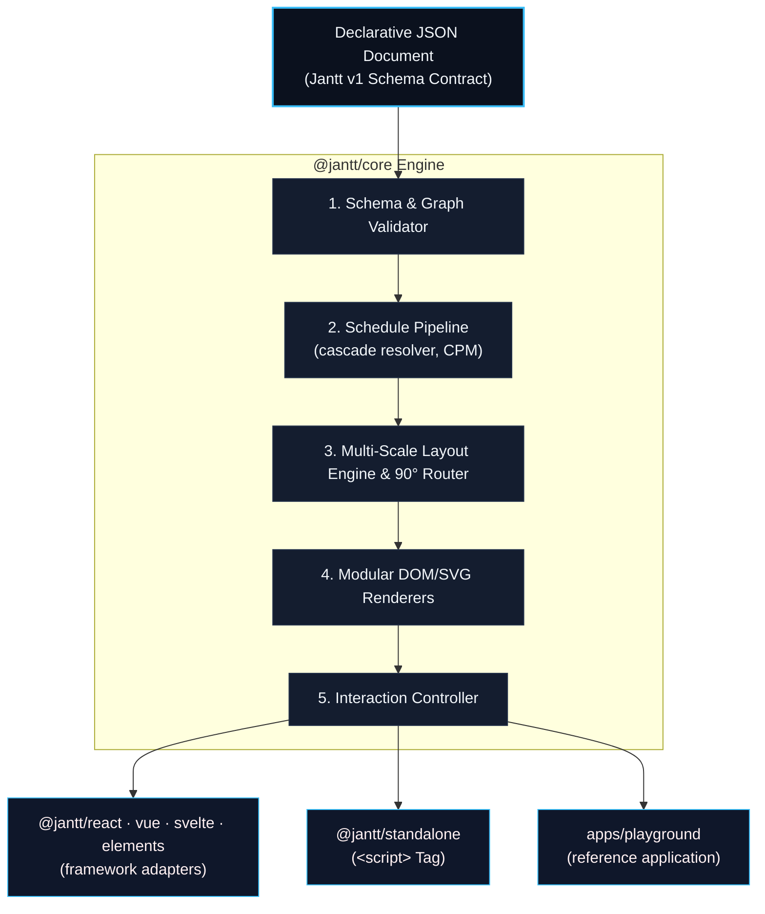

# Jantt Architecture & System Design

This document details the software architecture, design principles, module boundaries, and data flow of **Jantt - The JSON Gantt Chart Engine**.

---

## Architectural Principles

1. **JSON as the Single Source of Truth**:
   The entire application state is a single, serializable JSON document conforming to the Jantt schema v1 ([`schema/jantt.schema.json`](../schema/jantt.schema.json), published at `https://ahmadhassan-bted.github.io/Jantt/schema/v1.json`). There is no hidden internal runtime state that cannot be persisted back to the JSON file.
2. **Minimal Runtime Dependencies**:
   `@jantt/core` has exactly one runtime dependency, [`fflate`](https://www.npmjs.com/package/fflate), used to compress share-link payloads. Date calculations, coordinate layouts, constraint solvers, schema validators, and DOM renderers are written from first principles in TypeScript. `fflate` is kept external in the npm build so applications dedupe it; the script-tag and web-component bundles inline it.
3. **Pure Functional Transformations**:
   Core scheduling, critical path, layout, and validation algorithms are pure functions: `(State, Options) => Result`. They never mutate input data.
4. **Separation of Concerns & High Cohesion**:
   - **Date & Calendar Math**: Pure UTC date manipulation and working calendars.
   - **Validator**: Standalone syntax, semantic, and circular dependency checks.
   - **Scheduling**: Dependency parsing, cascade resolution, and Critical Path Method, composed as a pipeline.
   - **Layout**: Pixel coordinate mapping, multi-scale grids, and 90° orthogonal wire routing.
   - **Controller**: Pointer and keyboard interaction, one strategy class per gesture.
   - **Renderers**: Modular, decoupled DOM/SVG presentation subsystems.

---

## System Overview & Monorepo Topology

Packages that build on the core without the DOM renderer:

| Package | Role |
| :--- | :--- |
| `@jantt/interop` | MS Project XML, Primavera P6 XER and CSV import/export, executive HTML/SVG reports |
| `@jantt/render-canvas` | Virtualized 2D canvas renderer for very large plans |
| `@jantt/yjs` | Yjs CRDT binding, awareness (presence) and scoped undo |
| `@jantt/mcp` | Model Context Protocol server exposing plan tools to AI agents |
| `@jantt/cli` | Terminal tool: live two-way file sync, validation, audits, conversions |
| `worker/` | Cloudflare Worker CORS proxy used to load remote plans |
| `python/` | Python bridge (DataFrame conversion, Jupyter and Streamlit rendering via `@jantt/standalone`) |

---

## Subsystem Breakdown

### 1. Date & Calendar Math (`date-math.ts`, `calendar.ts`)
- **Isolation**: Pure UTC calendar manipulation.
- **Key Functions**: `addDays`, `diffDays`, `taskDurationDays`, `parseISODate`, `formatISODate`, `isValidISODate`, `isWeekend`; working calendars with `createCalendar`, `isWorkingDay`, `addWorkingDays` and regional statutory holidays.
- **Timezone Safety**: Avoids `Date` local timezone offset pitfalls by anchoring all parsing and serialization strictly in UTC (`getUTCFullYear`, `getUTCMonth`, `getUTCDate`).

### 2. Schema Validator (`validator.ts`)
- **Role**: Diagnostic engine that inspects raw JSON and returns actionable errors with repair suggestions.
- **Checks Performed**:
  - Top-level schema conformity (a `tasks` array is the only required root key).
  - Mandatory task properties (`id`, `category`, `start`, `end`) and unique task ids.
  - ISO-8601 calendar date validity (`YYYY-MM-DD`) and range sanity (`start <= end`).
  - Progress range (`0..1`) and baseline dates.
  - Category referential integrity, when a `categories` map is declared.
  - Dangling dependency checks (`dependsOn` refers to an existing task ID) and cycle detection.

### 3. Scheduling (`dependencies.ts`, `resolver.ts`, `cpm.ts`, `pipeline/`)
- **Dependencies** (`dependencies.ts`): parses `dependsOn` strings, arrays and objects into typed relations (FS, SS, FF, SF) with lead/lag, and builds the dependency graph used for cycle detection.
- **Cascade Resolver** (`resolver.ts`): moves every unlocked task to the earliest start its relations allow (plain links use `gapDays` or `meta.defaultGapDays`), preserving durations; locked tasks never move and tasks never move earlier.
- **Critical Path Method** (`cpm.ts`): two-pass forward/backward scheduling producing Early/Late Start and Finish, total and free float, critical and near-critical tasks.
- **Pipeline** (`pipeline/`): composes sanitize, cycle-guard, cascade-resolve and critical-path stages; also runnable off the main thread through `worker.ts`.
- **Analytics** built on the schedule: `evm.ts` (Earned Value), `pert.ts`, `monte-carlo.ts`, `schedule-health.ts` (DCMA-14 style audit), `resource-leveler.ts`, `baselines.ts`.

### 4. Layout Engine (`layout.ts`, `virtualizer.ts`)
- **Role**: Converts abstract task dates into exact pixel bounding boxes across multiple zoom scales. Default day widths come from `SCALE_DAY_WIDTHS` in `constants.ts`:
  - `day` (52px/day), `week` (24px/day), `month` (10px/day), `quarter` (4.5px/day), `year` (2.2px/day). A continuous `dayWidth` maps back to the nearest tier via `getScaleFromDayWidth`.
- **Milestones**: Detects zero-duration or explicit milestones (`milestone: true`) and produces diamond geometry.
- **Baselines**: Calculates ghost comparison bars (`baselineLayout`).
- **90° Orthogonal Router**: Generates clean right-angle SVG paths connecting prerequisite right edge to dependent left edge.
- **Virtualization**: `PlanVirtualizer` computes the visible row/column window so large plans render only what is on screen.

### 5. Interaction Controller (`controller.ts`, `controller/strategies/`)
- `InteractionController` owns selection, keyboard handling and the active gesture.
- One strategy per gesture: move, resize, progress, link, marquee selection, pan and splitter.
- Commits run the schedule cascade (when `autoCascade` is on, the default) and emit `onCommit` with a new immutable `JanttData`.

### 6. Rendering (`rendering/`, `renderers/`, `sidebar.ts`, `detail-modal.ts`)
- `rendering/jantt-engine.ts` coordinates data, viewport and renderers behind `renderJantt()`.
- `renderers/`: `toolbar.ts`, `grid-table.ts` (sticky multi-column grid and splitter), `timeline-header.ts` (year/month/day tiers), `timeline-grid.ts` (rows, weekends, today line), `dependency-links.ts` (SVG links and drag-to-link preview), `task-bars.ts` (bars, milestones, baselines, progress, link ports), `tooltip.ts`.
- `sidebar.ts` and `detail-modal.ts`: task detail drawer and modal.
- `themes/`: theme definitions and `themeManager`; `theme.css` is shipped as `@jantt/core/theme.css`.

### 7. Sync & Sharing (`remote-sync.ts`, `share-coder.ts`, `reconciliation/`, `firebase-sync.ts`)
- `remote-sync.ts`: normalizes GitHub/Dropbox/HTTPS plan URLs and fetches them with a timeout and a size limit.
- `share-coder.ts`: strips private fields and compresses plans into URL-safe share payloads (the `fflate` dependency).
- `reconciliation/`: content hashing, three-way and commutative plan merging with per-field timestamps and tombstones.
- `firebase-sync.ts`: Realtime Database room helpers (create, fetch, save, subscribe) and RTDB-safe key encoding.

---

## Security Architecture

- **No Dynamic Code Execution**: Jantt does not use `eval()`, `new Function()`, or dynamic template engines.
- **HTML Escaping Rule**: Renderers build some DOM through `innerHTML` templates. Every plan-derived string interpolated into such a template must pass through `escapeHtml()` (`utils.ts`), and colors through `sanitizeCssColor()` (`layout.ts`); prefer `textContent` and DOM APIs for new code. Escaping regressions are covered by renderer tests, not by a linter.
- **Dependency Surface**: The only runtime dependency of `@jantt/core` is `fflate`, which has no dependencies of its own. CI blocks merges on high or critical advisories in runtime dependencies (`npm audit --omit=dev`).
- **Collaboration Data**: Room authorization is enforced server-side by `database.rules.json`; share links and JSON exports are scrubbed of internal identifiers by `sanitizePlanForJson`.
